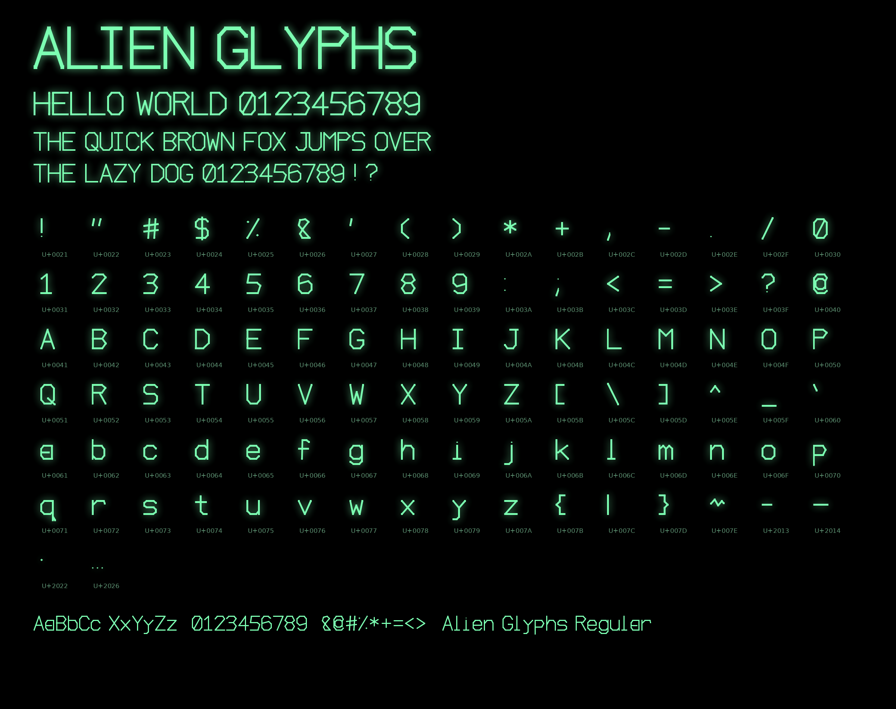

# Alien Glyphs

A thin, angular, segmented sci-fi display font — sharp 45°/90° strokes,
chevrons, open corners, and asymmetric cuts. No curves.



The font itself is monochrome; use `#7CFFB2` on black to recreate the
mint-green glow from the specimen.

## Files

- `AlienGlyphs-Regular.ttf` — installable TrueType font
- `AlienGlyphs-Regular.woff2` — web font (used by `preview.html`)
- `build_font.py` — data-driven source; edit glyph polylines and rebuild
- `specimen.png` — full specimen on black with mint-green glow
- `preview.html` — open in a browser, type in the box, see your text in Alien Glyphs
- `shaders/alien-hologram.glsl` — Ghostty hologram shader (green glow, scanlines, sweep)

## Character set (99 glyphs)

All printable ASCII 0x20–0x7E (95, including space) plus – — • …

- Uppercase: A B C D E F G H I J K L M N O P Q R S T U V W X Y Z
- Lowercase: a b c d e f g h i j k l m n o p q r s t u v w x y z (distinct small/variant forms, x-height)
- Digits: 0 1 2 3 4 5 6 7 8 9
- Symbols: . , ! ? : ; ' " ` - – — _ ( ) [ ] { } / \ | @ # $ % ^ & * + = < > ~ • …

## Install

### Windows
Right-click `AlienGlyphs-Regular.ttf` → Install, or copy to `C:\Windows\Fonts`.

### macOS
Double-click the TTF → Install Font (Font Book), or copy to `~/Library/Fonts`.

### Linux / NixOS
```bash
mkdir -p ~/.local/share/fonts
cp AlienGlyphs-Regular.ttf ~/.local/share/fonts/
fc-cache -f
fc-list | grep -i alien
```

### Web
Keep the WOFF2 next to `preview.html`; `@font-face` is already wired up.

### Ghostty

After installing the font (above), set in `~/.config/ghostty/config`:

```ini
font-family = "Alien Glyphs"
font-size = 12
```

Optional hologram shader (copy `shaders/alien-hologram.glsl` to
`~/.config/ghostty/shaders/alien-hologram.glsl` first):

```ini
custom-shader = shaders/alien-hologram.glsl
foreground = #7CFFB2
background = #020402
font-size = 10
```

Then open a new Ghostty window. Verify with:

```bash
ghostty +list-fonts | grep -i alien
ghostty +validate-config
```

## Build

Requires Python 3 and [fontTools](https://github.com/fonttools/fonttools):

```bash
pip install fonttools brotli
python build_font.py
```

Regenerates the TTF, WOFF2, specimen, and preview in place.

## Design notes

- 1000 UPM, cap height 700, x-height 490, stroke 64 units, only straight segments.
- Each glyph is defined in `build_font.py` as polylines on a 6×10 grid
  (`G` dict), expanded to filled outlines — tweak points, re-run, regenerate everything.
- Family: Alien Glyphs · Style: Regular · Version 1.0

## License

Alien Glyphs is licensed under the SIL Open Font License 1.1 — see
[LICENSE](LICENSE) for the full text.

Copyright 2026 Vincent.

No Reserved Font Name is claimed for "Alien Glyphs".
